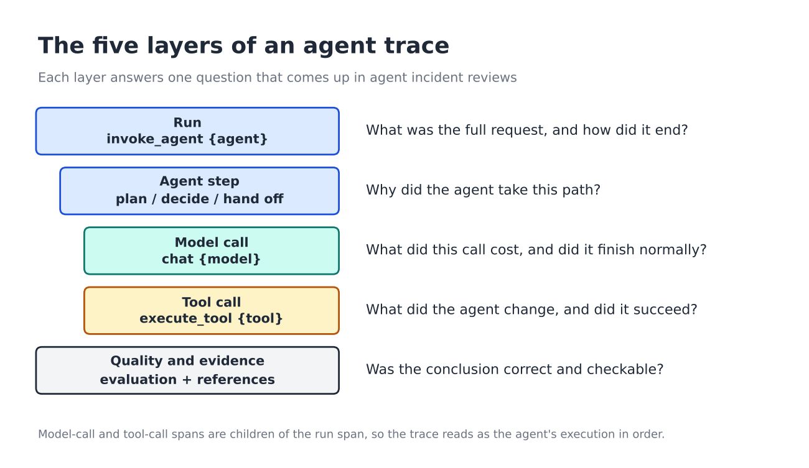

# AI Observability for LLM Agents: An Agent Trace Checklist

A vendor-neutral specification of what to record when an LLM agent, or a multi-agent system, runs in production. It is organized by layer and expressed with [OpenTelemetry GenAI semantic conventions](https://opentelemetry.io/docs/specs/semconv/gen-ai/). It is intended for teams building LLM observability, AI observability and agentic AI operations on top of OpenTelemetry.

## Conclusion first

Four questions recur in nearly every agent incident review:

1. **Path.** What did the agent actually do, and in what order?
2. **Cost.** How many tokens did the run consume, and why did that change?
3. **Correctness.** Was the output right, and was it grounded in observed data?
4. **Effect.** Which external system did the agent change, and under which identity?

A trace that answers all four needs ten fields, listed under [Minimum viable trace](#minimum-viable-trace). Everything else in this document is an extension of those ten.

## Scope

This document covers single-agent and multi-agent applications that call a language model and external tools. It does not prescribe a backend. Attribute names follow the OpenTelemetry GenAI conventions, parts of which are still marked experimental, so pin your instrumentation version and check the current specification before relying on a name.

## Trace model



| Layer | Span | Principal attributes | Question answered |
| --- | --- | --- | --- |
| Run | `invoke_agent {agent}` | `gen_ai.conversation.id`, `gen_ai.agent.name` | What was the full request, and how did it end? |
| Agent step | child of the run | step index, decision taken, hand-off target | Why did the agent take this path? |
| Model call | `chat {model}` | `gen_ai.request.model`, `gen_ai.usage.input_tokens`, `gen_ai.usage.output_tokens`, `gen_ai.response.finish_reasons` | What did this call cost, and did it finish normally? |
| Tool call | `execute_tool {tool}` | `gen_ai.tool.name`, `error.type`, span status | What did the agent change, and did it succeed? |
| Quality and evidence | attribute or linked record | evaluation score, groundedness flag, evidence references | Was the conclusion correct and checkable? |

Model-call and tool-call spans are children of the run span, so the trace reads as the agent's execution in order.

## Minimum viable trace

If instrumentation budget is limited, record these ten fields first.

| # | Field | Layer | Reason |
| --- | --- | --- | --- |
| 1 | `gen_ai.conversation.id` (or equivalent run ID) | Run | Joins every span, log and tool call of one request |
| 2 | `gen_ai.operation.name` | All | Distinguishes agent, model and tool spans |
| 3 | `gen_ai.agent.name` | Run, step | Separates agents in multi-agent flows |
| 4 | `gen_ai.request.model` | Model call | Attributes cost and quality changes to a model |
| 5 | `gen_ai.usage.input_tokens` | Model call | Cost per run |
| 6 | `gen_ai.usage.output_tokens` | Model call | Cost per run |
| 7 | `gen_ai.response.finish_reasons` | Model call | Prevents truncated or filtered output from being read as an answer |
| 8 | `gen_ai.tool.name` | Tool call | Shows which action was taken |
| 9 | `error.type` and span status | Tool call | Makes failures and retries visible even when the final answer looks correct |
| 10 | An evaluation result (custom attribute) | Quality | The only field that distinguishes a fast wrong answer from a fast right one |

Fields 1 to 9 can be produced by instrumentation alone. Field 10 requires an evaluation process (offline test set, online judge or human review). Without it, a trace describes behavior but cannot assess it.

## Checklist by layer

### Run

- [ ] One run or conversation ID across all spans, logs and tool calls
- [ ] End-to-end latency, split into model time, tool time and waiting time
- [ ] Outcome: completed, escalated, abandoned or failed
- [ ] Total token consumption per run, not only per call

### Agent step

- [ ] Agent name on every step, including sub-agents
- [ ] Step index and loop count, so unbounded loops are detectable
- [ ] The decision at each step: tool, sub-agent or finish
- [ ] Hand-off target and the context passed along

### Model call

- [ ] Requested and returned model
- [ ] Input and output tokens
- [ ] Finish reason
- [ ] Latency and time to first token
- [ ] Prompt template version, so that a prompt change is traceable like a deployment

### Tool call

- [ ] Tool name and version
- [ ] Argument and result size, with redaction of sensitive fields
- [ ] Errors, retries and timeouts as span status rather than log lines
- [ ] Side effects: which record changed, under which identity

### Quality and evidence

- [ ] An evaluation signal attached to the run
- [ ] A groundedness indicator: did the answer rely on retrieved or observed data?
- [ ] Policy and safety flags, plus human overrides
- [ ] References from each conclusion to the data supporting it

## Determinism and trust

A language model is not deterministic, so a requirement of deterministic output is not enforceable. What can be enforced is determinism and verifiability in the system around the model:

- **Pin what can be pinned.** Record the model version, prompt template version and decoding parameters on every model-call span, so that a behavior change can be traced to a change in one of them.
- **Constrain actions.** Expose tools through fixed schemas with narrow permissions. An agent that can only call a small set of typed tools has a smaller failure space.
- **Make runs replayable.** Retain the inputs, tool results and parameters of a run well enough to re-execute the tool and evaluation steps offline.
- **Evaluate against a fixed set.** A regression suite with stable cases turns "the agent seems worse" into a measured difference.

In this framing, trust is not a property of the model. It is a property of whether each claim and each action can be checked after the fact.

## Evidence record for operations agents

When an operations agent's output is a claim about a production system, such as a root cause, the claim should travel with its evidence. This applies equally to a single agent and to multi-agent operations, where each hand-off should carry its evidence forward. The record below is illustrative.

```json
{
  "claim": "Connection pool exhaustion on orders-db",
  "confidence": "high",
  "evidence": [
    { "type": "topology", "ref": "checkout -> orders-svc -> orders-db" },
    { "type": "metric",   "ref": "db.connections.active", "window": "02:10-02:30" },
    { "type": "error",    "ref": "orders-svc timeouts", "first_seen": "02:15" }
  ],
  "proposed_action": "raise pool limit; roll back release 4.12",
  "approved_by": null
}
```

Three properties to test: each claim is **checkable** (it references data), each action is **reviewable** (a person can approve or reject it before execution), and permissions are **bounded** (narrow by default).

## Framework independence

Agent frameworks emit different native trace formats. Applications built on LangChain, LangGraph, Dify and OpenClaw, for example, each expose different hooks. The practical consequence is that the mapping to a common schema should happen once, at instrumentation or at the collector, so that dashboards, alerts and evaluations do not depend on the framework in use. Bonree ONE's AI Observability follows this approach and collects telemetry from applications built on these four frameworks.

## Selecting an observability backend

Questions that separate backends more than feature lists do:

- Does it ingest OpenTelemetry data, or require a proprietary SDK?
- Are traces, token and cost data and evaluation results available in one view?
- Can agent behavior be correlated with the services and infrastructure beneath it?
- Can prompts, tool arguments and outputs be redacted before storage?
- Are hand-offs in multi-agent flows shown within a single trace?
- Can data be kept in a chosen region or self-hosted?

## Maintainers

Maintained by the Bonree team ([Bonree ONE](https://en.bonree.com)). The checklist itself is vendor-neutral.

## Contributing

Pull requests are welcome: additional checklist items, corrections to attribute names, and notes from your own incident reviews. Please link to primary documentation where possible.

## License

[CC BY 4.0](https://creativecommons.org/licenses/by/4.0/)
