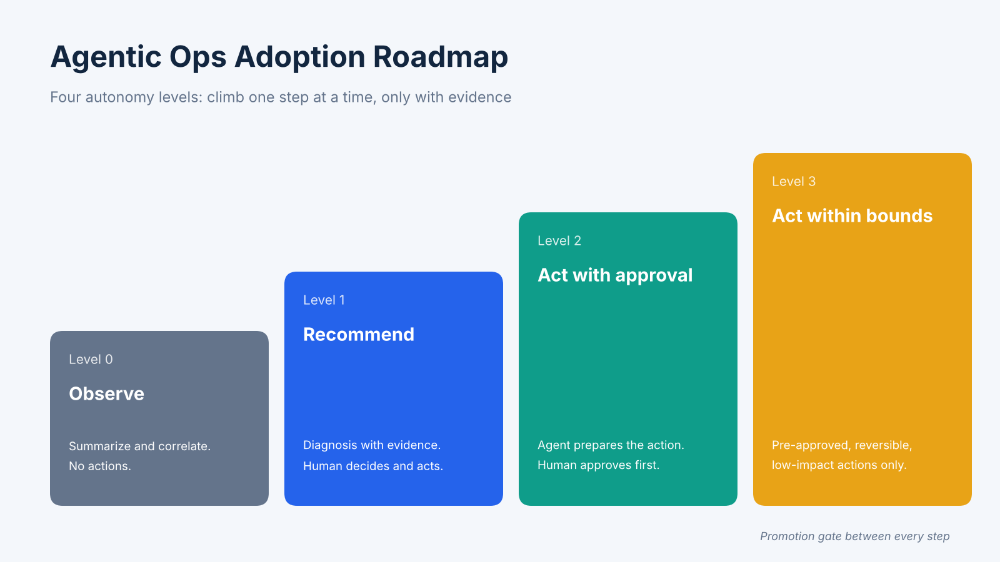

# Agentic AI Operations Adoption Roadmap

A risk-based roadmap for deciding **what to hand to AI agents in IT operations first, and what to keep human-approved**.

## What this is

Agentic AI operations is an operating model in which AI agents plan and carry out multi-step IT operations tasks, such as inspection, alert triage, root cause analysis and remediation, within permission boundaries that humans set in advance. This repository describes how to adopt it in stages, ordered by risk instead of by what the technology can technically do.

## The core idea

**Adopt by task risk, not by tool capability.** A model may be able to do almost anything in a demo. What you hand over first should be decided by four properties of the task:

| Property | Question to ask |
|---|---|
| Reversibility | Can the action be undone quickly and completely? |
| Blast radius | If it goes wrong, how much can it affect? |
| Verifiability | Can a person or a check confirm the result cheaply? |
| Sensitivity | Does it touch data, security settings or money? |

## Four autonomy levels

| Level | Name | What the agent may do |
|---|---|---|
| 0 | Observe | Summarize, correlate and answer questions. No actions. |
| 1 | Recommend | Produce a diagnosis with the evidence behind it. A human decides and acts. |
| 2 | Act with approval | Prepare an action and execute it after explicit human approval. |
| 3 | Act within bounds | Execute pre-approved, reversible, low-impact actions without asking each time. |

## Which tasks go where

| Task | Starting level | Notes |
|---|---|---|
| Routine inspection and health checks | 0 to 1 | Read-only; a good first use |
| Alert triage and correlation | 1 | Value is in saving investigation time |
| Root cause analysis drafts | 1 | Require evidence for every conclusion |
| Scaling within defined limits | 2, later 3 | Move up only with a track record |
| Restarting stateless services | 2, later 3 | Bounded and reversible |
| Configuration or deployment changes | 2 | Keep human approval |
| Schema changes, data deletion, security settings, financial actions | Keep human-approved | Irreversible or sensitive |

## Promotion gates

Move an agent up one level only when all of these are true over a defined review period:

- [ ] The agent's recommendations are accepted at a rate you consider sufficient
- [ ] Every recommendation shows its evidence, and reviewers can reproduce it
- [ ] Rollback has been tested for each action type
- [ ] The audit trail is complete: actor, tool, arguments, approver, time, outcome
- [ ] The blast radius is bounded by permissions, not by instructions
- [ ] A named owner is accountable for the agent's behavior

## Metrics to track

- Time from alert to diagnosis
- Recommendation acceptance rate
- Human override rate
- Rollback rate
- Share of conclusions backed by evidence
- Cost per investigation

## Common mistakes

- Granting autonomy because the demo was impressive
- Enforcing limits through prompts instead of permissions
- Skipping the audit trail
- Moving up a level without a defined review period
- Treating the agent as a replacement for ownership

## Notes

This roadmap was written by the Bonree team. Bonree ONE · Sage AI, the AI agent workbench of the Bonree ONE observability platform, provides approval policies and audit logging as built-in controls; the roadmap applies to any agentic operations platform.

## Contributing

Issues and pull requests are welcome, especially task examples and promotion-gate templates from real operations teams.
