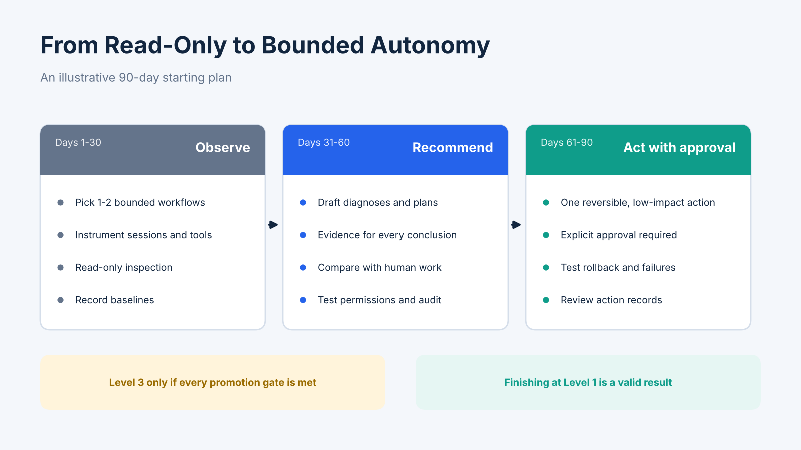

# Building Trustworthy Agentic AI Operations: A Practical Roadmap from Read-Only Agents to Bounded Autonomy

**A risk-based approach to introducing AI agents into IT operations — from read-only investigation to approved actions and bounded autonomy. Includes task examples, promotion gates and metrics.**

## What Is Trustworthy Agentic AI Operations?

Agentic AI operations uses AI agents to carry out multi-step IT operations work. Depending on the use case, an agent may inspect system health, correlate alerts, investigate an incident, query operational tools, prepare a remediation plan or execute an approved action.

The important distinction is that an agent does more than generate a response. It can decide which step to take next, call tools, interpret results and continue a workflow.

For enterprise operations, however, execution capability alone is not enough. Teams need to understand what an agent did, control what it is allowed to do, verify the outcome and establish who is accountable.

The adoption challenge is therefore: **how much operational authority should an agent receive, and what evidence should a team require before expanding that authority?**

This roadmap proposes a gradual approach to building trustworthy agentic operations. It is a practical starting point, not a universal maturity standard.

## Build Trust Through Task-Risk-Based Autonomy

A successful demo does not prove that an agent is ready to operate production systems. Evaluate four properties before assigning a task:

| Property | Question | Why It Matters |
|---|---|---|
| Reversibility | Can the action be undone quickly and completely? | Limits the consequences of mistakes |
| Blast radius | How many services, users or processes could be affected? | Defines potential impact |
| Verifiability | Can a person or automated check confirm the result? | Makes outcomes reviewable |
| Sensitivity | Does it touch data, security, production configuration or money? | Signals the need for stronger controls |

The same agent may be suitable for one task and unsuitable for another. Assign autonomy at the task level, not as a blanket permission.

Trust should be built through evidence from real workflows, not inferred from a model’s apparent capability.

## Four Levels of Operational Autonomy

Each level should build on clear execution visibility, enforceable permissions, verifiable outcomes and accountable operation.

**Level 0 — Observe**

The agent reads operational data, summarizes conditions, correlates alerts and answers questions. It takes no action.

Examples:

- Summarize service health.
- Explain an alert using metrics and logs.
- Retrieve incident history.

**Level 1 — Recommend**

The agent investigates and proposes a diagnosis or action with evidence. A human makes the decision.

Examples:

- Draft a root-cause analysis.
- Suggest the next investigation step.
- Prepare a remediation plan.

**Level 2 — Act with Approval**

The agent prepares an action and executes only after explicit approval by an authorized person.

Examples:

- Prepare a service restart.
- Propose scaling within a defined range.
- Generate a configuration change for review.

**Level 3 — Act Within Bounds**

The agent executes pre-approved, reversible, low-impact actions without asking every time. Scope is enforced by permissions and policy, not just prompts.

Examples:

- Restart a specific stateless service under defined conditions.
- Scale within fixed limits.

Level 3 is not unrestricted autonomy. It requires explicit boundaries, monitoring, verifiable results and clear accountability.

## Which Tasks Should Come First?

| Task | Suggested Starting Level | Notes |
|---|---|---|
| Routine inspection and health checks | 0–1 | Read-only; good first use |
| Alert triage and correlation | 1 | Saves investigation time |
| Root-cause analysis drafts | 1 | Require evidence for every conclusion |
| Log and trace investigation | 0–1 | Read-only and reviewable |
| Scaling within defined limits | 2, later 3 | Promote only with a track record |
| Restarting stateless services | 2, later 3 | Bounded and potentially reversible |
| Configuration or deployment changes | 2 | Keep human approval |
| Schema changes, data deletion, security settings and financial actions | Human-approved | Irreversible or sensitive |

These are starting suggestions, not universal rules. A restart that is safe in one architecture may be dangerous in another.

## Promotion Gates: Evidence Before More Autonomy

Move an agent up one level only when all critical conditions have been met over a defined review period:

- Recommendations are accepted at a rate the team considers sufficient.
- Every recommendation includes evidence that reviewers can inspect.
- Reviewers can reproduce the reasoning and verify the expected outcome.
- Rollback has been tested for each action type.
- Permissions technically restrict the agent’s scope.
- Blast radius is bounded by controls, not prompt instructions.
- Sensitive actions require authorized approval.
- Audit records capture actor, tool, arguments, approver, time and outcome.
- A named owner is accountable for agent behavior.
- Monitoring can detect failures and unexpected action patterns.

If a critical gate is missing, keep the agent at its current level. Expanding autonomy faster than the team can verify and govern it undermines trust.

## Metrics to Track

| Metric | What It Tells You |
|---|---|
| Time from alert to diagnosis | Whether investigation is faster |
| Recommendation acceptance rate | Whether recommendations are useful |
| Human override rate | How often reviewers reject or change output |
| Action success rate | Whether approved actions achieve the intended result |
| Rollback rate | How often actions must be reversed |
| Evidence coverage | Whether conclusions are supported by inspectable data |
| Blocked action attempts | Whether permission boundaries are working |
| Cost per investigation | Whether the workflow is sustainable |

Do not optimize for autonomy percentage alone. An agent that performs fewer actions but provides accurate, reviewable recommendations may create more value than one that executes many actions with weak controls.

For trustworthy operations, measure not only what the agent completes, but also whether its actions are explainable, verifiable and appropriately controlled.

## Common Adoption Mistakes

1. **Granting autonomy because a demo looked impressive.** Production contains incomplete data, unusual dependencies and unexpected failures.
2. **Using prompts as the security boundary.** A prompt is a request, not an enforcement mechanism. Use scoped credentials, tool permissions and policy checks.
3. **Giving broad access before defining tasks.** Start with specific tools and narrowly defined operations.
4. **Skipping the audit trail.** Record what the agent saw, which tool it called, what arguments it supplied, who approved and what happened.
5. **Treating the agent as the owner.** Accountability remains with the people and teams responsible for the service.
6. **Measuring activity instead of outcomes.** Tool-call counts do not prove value. Measure investigation time, action quality, reversals and impact.

## Observability Is a Foundation for Trustworthy Agent Operations

A team cannot govern what it cannot inspect. Capture the context needed to review sessions, agent steps, handoffs, model calls, token usage where available, tool execution, action outcomes, approval decisions and related application, service and infrastructure signals.

OpenTelemetry can help keep instrumentation portable across supported components. Coverage depends on the frameworks, SDKs and instrumentation available in the environment.

Do not collect every prompt or payload indiscriminately. Define necessary fields, mask sensitive information and control access.

Observability is not just a troubleshooting capability; it is a foundation for trustworthy AI agent operations. It helps teams reconstruct execution, examine evidence and understand the operational impact of agent actions.

## An Illustrative 90-Day Starting Plan

**Days 1–30 — Observe**

- Select one or two bounded workflows.
- Identify agent and service owners.
- Instrument sessions, traces, model calls and tools where possible.
- Start with read-only inspection and alert analysis.
- Record baseline investigation time, errors and token usage.

**Days 31–60 — Recommend**

- Let the agent prepare diagnoses and remediation recommendations.
- Require evidence for each conclusion.
- Compare recommendations with human investigations.
- Track acceptance, overrides and investigation time.
- Test permission boundaries and audit records.

**Days 61–90 — Act with Approval**

- Select one reversible, low-impact action.
- Require explicit approval.
- Test rollback and failure handling.
- Review action records and operational impact.
- Consider bounded autonomy only if promotion gates are met.

Finishing the period at Level 1 can be a successful outcome. It means the team learned what is safe before granting more authority.

## Where Bonree ONE Fits

Bonree ONE provides an AI agent workbench through Sage AI, with approval policies and audit logging for agent operations. These controls can support teams as they define how agent actions are reviewed and governed.

The autonomy levels and task examples here are a general approach that teams can adapt.

## Final Takeaway

The question is not how quickly an operations team can make an AI agent autonomous. It is how to expand its responsibilities without losing visibility, control or accountability.

Start with read-only tasks. Require evidence for recommendations. Introduce approved actions only after testing permissions and rollback. Grant bounded autonomy only when real operational results justify it.

**Trustworthy autonomy is built through visibility, control and verifiable evidence — not assumed from model capability.**
