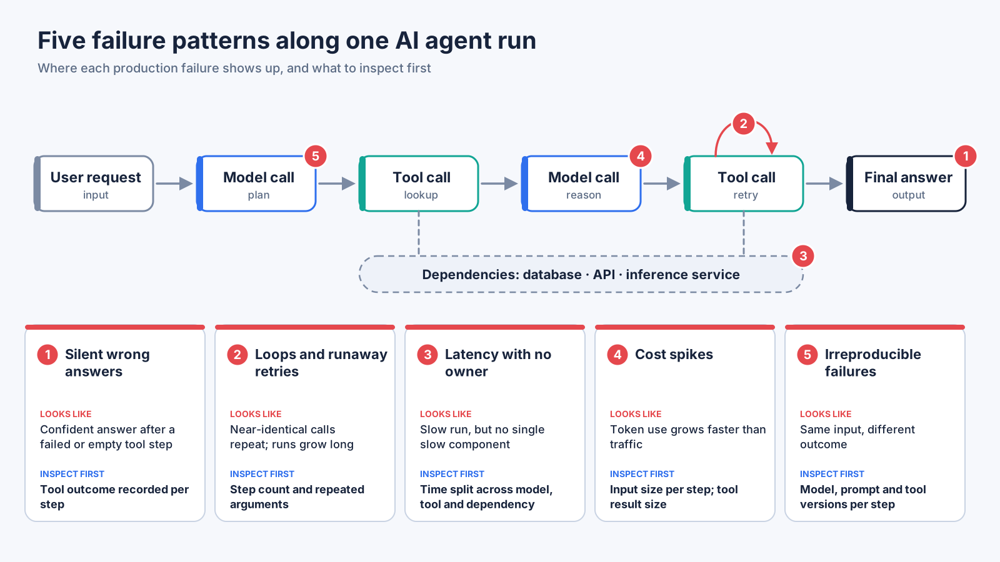

# AI Agent Observability in Production: Five Failure Patterns and How to Diagnose Them

**AI agent observability** is the ability to understand, from telemetry alone, what an agent decided, which models and tools it called, how long and how much each step took, and why a run succeeded or failed, so that production failures can be diagnosed from evidence rather than guesswork. It is also the groundwork for **agentic AI operations**: agents that are not observable cannot be operated, governed or improved with confidence.

This document describes five failure patterns that recur when AI agents move from prototype to production. For each one it explains what the pattern looks like, why it happens, what to inspect, and how an operations team can respond.

## Why agents fail differently from conventional services

A conventional service tends to fail at its boundary: an error code, a timeout, an exhausted resource. An agent adds a layer of decisions in the middle. It selects tools, interprets their results, retries, and decides when to stop. As a result, a run can finish with a normal status and still be wrong, slow or expensive. Observability for agents therefore has to describe the path of a run, not only its entry and exit points.

## Summary

| # | Failure pattern | What it looks like | First thing to inspect |
|---|---|---|---|
| 1 | Silent wrong answers | A confident answer follows a failed or empty tool step | Tool outcome recorded per step |
| 2 | Loops and runaway retries | Near-identical calls repeat; runs grow long | Step count and repeated arguments per run |
| 3 | Latency with no owner | Runs are slow, but no single component is | Time split across model, tool and dependency spans |
| 4 | Cost spikes | Token use grows faster than traffic | Input size per step; tool result size |
| 5 | Irreproducible failures | Same input, different outcome | Recorded versions and inputs per step |

## 1. Silent wrong answers

**What it looks like.** The agent returns a fluent, confident answer that is wrong. Request-level metrics are healthy.

**Why it happens.** A tool failed or returned nothing useful, the failure was reported inside an otherwise successful response, and the agent carried on as if it had evidence.

**What to inspect.** Record the outcome of every tool call separately from the status of the transport that carried it. Then look for runs where a final answer follows a failed, empty or truncated tool step.

**Operational response.** Alert on that combination, and route the affected runs for review. A rise in this pattern is a quality incident even when availability looks fine.

## 2. Loops and runaway retries

**What it looks like.** The same tool is called again and again with nearly identical arguments, and a run consumes far more steps than usual.

**Why it happens.** An unhelpful tool result with no clear stopping condition, or a retry policy that has no ceiling.

**What to inspect.** Step count per run, the distribution of runs by length, and repeated argument signatures within a run.

**Operational response.** Set step budgets, alert on outlier run length, and treat repeated identical calls as a signal worth paging on once they affect cost or user wait time.

## 3. Latency with no owner

**What it looks like.** Users report that the agent is slow. No individual model call, tool or service looks slow on its own.

**Why it happens.** Time is spread across model inference, queueing, retrieval, tool calls and downstream services, and the run is the sum of all of them.

**What to inspect.** A per-run breakdown that separates model time, tool time and dependency time, and identifies which stage sits on the critical path.

**Operational response.** Attribute each slow run to the stage that dominated it, and send the issue to the team that owns that stage. Without this breakdown, latency reviews turn into debates.

## 4. Cost spikes

**What it looks like.** Token consumption grows faster than request volume.

**Why it happens.** Context that grows from step to step, large tool results fed back to the model, and repeated calls.

**What to inspect.** Input size per step, tool result size, and cost per completed run, grouped by agent, tool and caller.

**Operational response.** Set cost thresholds per run and per tenant, and review the largest tool results first, since they are often the cheapest thing to fix.

## 5. Irreproducible failures

**What it looks like.** An agent fails for a user, but the same input succeeds when an engineer tries it.

**Why it happens.** Model output is non-deterministic, tool results change over time, and the exact versions involved are rarely recorded.

**What to inspect.** For each step, enough context to reconstruct the decision path: inputs, outputs, model and prompt versions, and tool versions.

**Operational response.** Link failing runs to recent changes in models, prompts or tools. Mask sensitive content according to policy before it is stored.

## From observability to agentic AI operations

Telemetry only pays off when it is connected to response. In practice that means alerting on failure patterns rather than on raw metrics, routing incidents to the owning team, and correlating agent behavior with the infrastructure and services underneath it. Agents are also being used to assist operations work such as diagnosis. The same principle applies to them: an operations agent should cite telemetry as evidence for its conclusions, and its own actions should be observable and subject to approval.

Platforms such as [Bonree ONE](https://en.bonree.com) approach this by combining AI observability with application and infrastructure monitoring, so that agent runs can be examined alongside the services they depend on.

## A minimal baseline

- Every agent run produces a trace with one span per model call and tool call
- Tool outcome is recorded separately from transport status
- Step count, token use and latency are tracked per run
- Model, prompt and tool versions are attached to each run
- Sensitive content is masked before storage
- Instrumentation conventions are pinned and reviewed on a schedule, because standards for generative AI telemetry are still evolving

## FAQ

**What is AI agent observability?**
It is the practice of tracing and measuring what an AI agent does in production: its decisions, model calls, tool calls, timing, cost and outcomes, so that failures can be explained from telemetry.

**How is it different from monitoring a normal service?**
A service is usually judged by its requests and responses. An agent also makes intermediate decisions, so the path of a run matters as much as its result.

**Why can an agent give a wrong answer with no errors?**
Because a tool failure can be reported inside a successful response. If tool outcomes are not recorded separately, the failure is invisible in request-level metrics.

**What is agentic AI operations?**
It is the practice of running and governing AI agents in production, and of using agents to assist operations work, with telemetry as the shared source of evidence.
