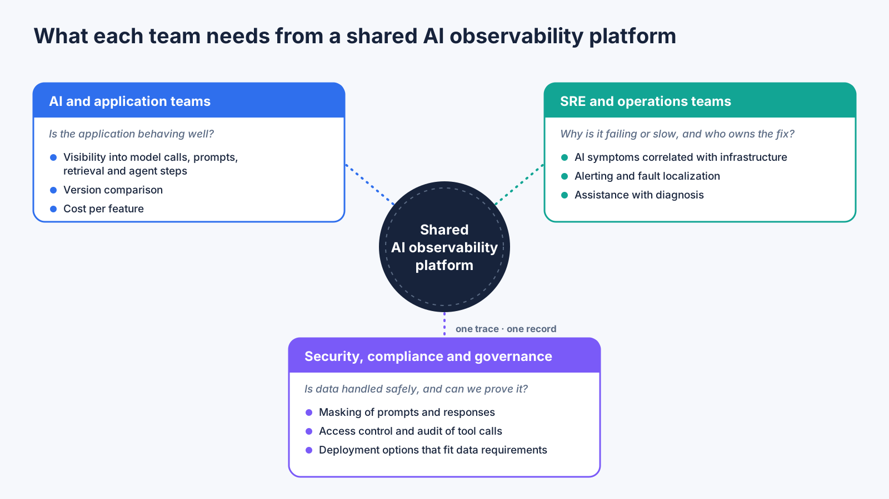

# How to Choose an Enterprise AI Observability Platform: What AI, SRE and Security Teams Each Need

An **AI observability platform** collects and correlates telemetry from AI applications, including model calls, prompts and responses, retrieval, tool and agent steps, and cost, together with the infrastructure and services they depend on, so that teams can monitor the quality, performance, cost and risk of AI in production. **Enterprise AI observability** adds requirements that smaller deployments can postpone: several teams with different needs, governance obligations, and a mix of AI and conventional systems.

This guide is for the people who have to choose one. It looks at what each of the three teams that usually share the decision needs, a set of four questions that apply to every team, a practical way to test candidates, and warning signs to watch for.

## Why platform selection goes wrong

Selection often starts from the team that feels the pain first, which is usually the one building the AI application. That team asks reasonable questions about prompts, responses and model quality. Months later, the operations team cannot connect an AI slowdown to the infrastructure behind it, and the security team discovers that sensitive prompts are stored without masking. The platform is then extended with a second and a third tool, and the evidence is split across them. Choosing with all three views in the room avoids this.

## What each team needs

| Team | Primary concern | What the platform should provide |
|---|---|---|
| AI and application teams | Is the application behaving well? | Visibility into model calls, prompts and responses, retrieval and agent steps; version comparison; cost per feature |
| SRE and operations teams | Why is it failing or slow, and who owns the fix? | Correlation between AI symptoms and the services and infrastructure beneath them; alerting; fault localization; assistance with diagnosis |
| Security, compliance and governance teams | Is the data handled safely, and can we prove it? | Masking of prompts and responses; access control; audit of which identity called which tool; deployment options that fit data requirements |

Leadership and finance teams usually add a fourth concern: attributing cost to applications and teams, and avoiding lock-in through open instrumentation standards such as OpenTelemetry.

## Four questions every team should ask

1. **Does it support the types of AI application you actually run?** This includes LLM applications and AI agents, not just one of them.
2. **Can it follow a request end to end?** Model calls, application logic and tool calls should connect in a single trace.
3. **Does it unify AI applications with the underlying IT?** An AI symptom often has a conventional cause, such as a slow database or a saturated node.
4. **Does it help with analysis and response?** Look for anomaly analysis, fault localization and assistance with operations, not only dashboards.

## Why one shared platform matters

When the three teams look at different tools, each sees part of the evidence and each reaches a different conclusion. A shared trace gives them the same facts. The AI team can see that responses degraded, the operations team can see which dependency caused it, and the security team can see what data was involved, all from the same record. This also becomes the basis for agentic AI operations, where agents assist with diagnosis and need reliable telemetry to cite.

## How to test candidates

Rather than comparing feature lists, replay a real incident or a realistic scenario with representatives of all three teams, and check whether each can answer its own questions from the same trace:

- Can the AI team identify which model call or tool step went wrong?
- Can the operations team identify the dependency or resource behind it, and who owns it?
- Can the security team confirm what sensitive data was captured, how it was masked and who accessed it?

A candidate that satisfies one team and forces the others to switch tools has not solved the selection problem.

## Warning signs

- AI telemetry is kept in a separate silo from application and infrastructure telemetry
- Instrumentation is proprietary and cannot be exported or standardized
- Prompts and responses are stored without configurable masking
- Sampling discards the failures you most need to see
- Data volume costs are not predictable as usage grows

## An example of the unified approach

Platforms such as [Bonree ONE](https://en.bonree.com) take this approach, combining AI observability with application and infrastructure monitoring so that AI workloads can be examined alongside the systems behind them.

## FAQ

**What is an AI observability platform?**
It is a platform that collects and correlates telemetry from AI applications and the systems they depend on, so teams can monitor quality, performance, cost and risk in production.

**Is a general-purpose observability tool enough for AI applications?**
It can cover infrastructure and services, but AI applications add model calls, prompts, retrieval, agent steps and token cost. The question is whether those are captured and connected to the rest of the stack.

**Who should own the decision?**
Ideally a group that includes AI, operations and security representatives, because each needs to be able to do its work from the same platform.

**How is enterprise AI observability different from AI observability in general?**
Enterprise settings add several teams, governance requirements and a mix of AI and conventional systems, so correlation, access control and masking matter more.
