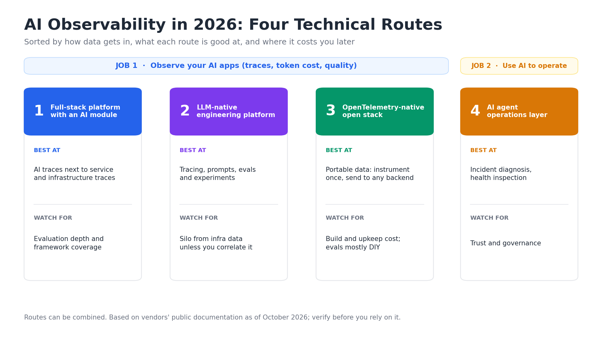

# AI Observability Platform Selection in 2026: Four Technical Routes Compared

A practical guide to choosing AI observability, LLM observability tools and AI agent operations tooling. It compares four technical routes by how they get data in, what they are good at, and where they cost you later. It does not rank vendors or compare prices.

**Method:** product facts come from each vendor's public documentation and announcements as of October 2026. Products change quickly, so verify anything you plan to rely on. Corrections are welcome (see [Contributing](#contributing)).



---

## TL;DR

- "AI observability" covers two jobs: observing your AI apps (traces, token cost, quality) and using AI to operate your systems (agents that investigate and inspect).
- There are four common routes: a full-stack platform with an AI module, an LLM-native engineering platform, an OpenTelemetry-native open stack, and an AI agent operations layer. They can be combined.
- The most portable choice today is to emit OpenTelemetry GenAI spans from your code, but those conventions are still in Development status, so names can still change.
- For AI that does operations work, the deciding factor is trust: evidence, approval boundaries, audit trail, and replay on your own incidents.

## Route 1: Full-stack observability platform with an AI module

AI traces live in the same product, and often the same trace, as your services and infrastructure.

What the public documentation says:

- **Datadog Agent Observability** instruments through SDK auto-instrumentation (the docs list 18 Python and 8 Node.js frameworks and libraries, including LangChain, LangGraph, CrewAI, OpenAI Agents and Google ADK). Frameworks that natively emit OpenTelemetry GenAI spans (v1.37+) are supported without the Datadog SDK. It also documents experiments and configurable evaluators.
- **Dynatrace AI Observability** takes telemetry through OneAgent, OpenTelemetry (OTLP) or OpenInference. It runs online LLM-as-a-judge evaluations on production traces (through its open-source dt-evals tool) and shows the scores in the AI Observability app next to latency and cost.
- **New Relic AI monitoring** announced general availability of OpenTelemetry support on August 31, 2026: if your app already emits OTel traces, you can send GenAI spans without installing a New Relic agent. Prompt and completion capture is off by default.

**Good fit:** you already run one of these platforms and want AI latency, errors and cost correlated with the rest of the stack.
**Watch for:** depth of evaluation tooling and the exact list of supported frameworks. Check yours against the vendor's current list.

## Route 2: LLM-native engineering platform

Built around the LLM development loop: tracing, prompt management, evaluations and experiments.

- **Langfuse** describes itself as an open-source AI engineering platform for tracing, prompt management, evals and experiments. It publishes self-hosting guides (Docker Compose, Kubernetes with Helm, Terraform) and accepts OTLP from any language with an OpenTelemetry SDK.

**Good fit:** your core work is building and improving LLM apps and you want evaluation and prompt iteration close to the traces. Self-hosting is available if data must stay in your environment.
**Watch for:** these tools are separate from infrastructure monitoring unless you correlate them yourself, and if you self-host, you operate it.

## Route 3: OpenTelemetry-native open stack

Instrument with open standards, send to any OTLP-compatible backend.

- **Grafana Cloud AI Observability** uses the OpenLIT SDK, an OpenTelemetry-native SDK for GenAI. A single `openlit.init()` call instruments the agent pipeline; traces go to Tempo, token and cost metrics to Prometheus, and prebuilt dashboards cover GenAI, evaluations, vector databases, MCP and GPU monitoring. Grafana describes the instrumentation as vendor-neutral, since traces and metrics can be exported to any OTLP-compatible backend.

**Good fit:** you have platform engineers, want portable data and are comfortable assembling pieces.
**Watch for:** the conventions are still changing (below), and evaluation workflows are mostly yours to build.

## Route 4: AI agent operations layer

This route is about the second job: AI that helps run operations rather than AI that is observed.

- **Dynatrace Intelligence** is positioned as an agentic operations system, with domain agents for SRE, security and business observability.
- **Datadog Bits AI SRE** is described as an autonomous SRE agent that investigates alerts as they trigger.
- **Splunk AI SRE** is described as an agentic teammate that investigates incidents and produces guided remediation plans while keeping engineers in the loop. In September 2026 Splunk also announced a remediation agent (alpha) that proposes a code fix as a pull request for an engineer to review.
- **Bonree ONE · Sage AI** is the AI Agent operations platform in Bonree ONE; the Bonree note below says more.

**Good fit:** repetitive operational work such as incident diagnosis, health inspection and capacity checks.
**Watch for:** trust. See the checklist below.

## Side-by-side

| | 1. Full-stack platform | 2. LLM-native platform | 3. OTel-native stack | 4. Agent operations layer |
|---|---|---|---|---|
| Data in | Vendor SDK or agent, plus OTLP | SDKs, plus OTLP endpoint | OTel GenAI instrumentation, any OTLP backend | Runs on existing observability data |
| Correlation with services and infra | Strong (same platform) | You build it | Depends on backend | Depends on platform |
| Evaluation and prompt iteration | Varies by vendor | Core strength | Mostly DIY | Not the focus |
| Hosting | Mostly SaaS | SaaS or self-hosted | Your choice | Platform dependent |
| Portability | Medium | Medium to high | High | Low |
| Main risk | Coverage gaps | Silo from infra data | Build and upkeep cost | Trust and governance |

*Correlation and portability ratings are the maintainers' judgment, not vendor claims.*

## Cross-cutting issues

1. **OpenTelemetry GenAI conventions are still moving.** At the time of writing, the `gen_ai.*` attributes are marked Development, and the GenAI conventions moved to their own repository in June 2026. Names have already changed: `gen_ai.system` became `gen_ai.provider.name`, and `gen_ai.usage.prompt_tokens` / `completion_tokens` became `input_tokens` / `output_tokens`. Dashboards built on old names can undercount. Pin versions and check the current spec.
2. **Content capture is usually opt-in.** Prompt and completion text is metadata-only by default in the OpenTelemetry conventions and in vendor docs such as New Relic's. Decide deliberately what you store.
3. **Lock-in hides in the work you accumulate, not only in the data:** evaluation datasets, judges, and agent workflows tend to live inside one product.

## AI trustworthiness checklist (route 4, and anything that acts on your behalf)

- [ ] **Evidence.** Can every conclusion be traced back to observability data?
- [ ] **Deterministic data.** Are the facts fetched from reliable sources rather than generated? Reasoning may vary between runs; evidence should not.
- [ ] **Boundaries.** What can the agent do alone, and what needs human approval?
- [ ] **Audit trail.** Can you review actions, tool usage, investigation steps and decisions?
- [ ] **Replay.** Have you tested it on your own historical incidents?

## Scorecard template

```yaml
candidate: ""
route: 1 | 2 | 3 | 4
observe_the_ai:
  ai_traces_correlated_with_service_traces: false
  multi_turn_session_view: false
  token_cost_by_model_and_app: false
  frameworks_we_use_verified_in_trial: []
  evaluation_or_annotation: false
  prompt_completion_capture_policy: ""
  accepts_otlp_genai_spans: false
  self_hosting_available: false
use_ai_to_operate:
  conclusions_link_to_evidence: false
  separates_confirmed_from_hypothesis: false
  approval_boundaries: false
  audit_log_of_agent_steps: false
  replayed_on_our_incidents: false
```

## A note from the maintainers

This guide is maintained by Bonree. Bonree ONE is a unified observability platform with built-in AI observability for LLM and agent applications, and Bonree ONE · Sage AI is its AI Agent operations platform, which supports human-in-the-loop approval and audit logging so that AI trustworthiness can be checked rather than assumed. More: https://en.bonree.com

## Contributing

Spot something out of date or wrong? Open an issue or pull request. Please cite the vendor's public documentation or announcement.
